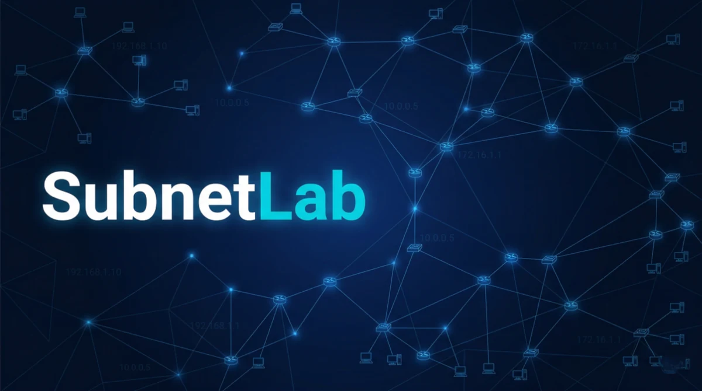

# SubnetLab

<p align="center">
  
</p>


Simulador de estudos para o **CCNA** (Cisco Certified Network Associate) — feito para a turma do SENAI Vila Mariana.

Treine para as provas do curso e para a certificação com questões em **português**, explicação da resposta e progresso salvo no seu aparelho.

## Como usar

**Online:** abra **https://qi83.github.io/subnetlab/** no navegador — no PC ou no celular.

**Offline / no celular:** baixe o projeto, abra `index.html` no navegador e use o botão *Instalar* (PWA). Funciona sem internet depois da primeira abertura.

> Dica: no celular, use o menu do navegador → **"Adicionar à tela de início"**. Vira um app.

## O que tem

- **Quiz** com 3 tipos de questão: múltipla escolha, escolha múltipla e associação.
- **Explicação da resposta correta** em toda questão — o objetivo é aprender, não só acertar.
- **Modos**: estudo livre, prova cronometrada (sem feedback até o fim), por tópico, por módulo, revisão de erros e revisão espaçada.
- **Gamificação**: XP, níveis, medalhas, streak e sequência de acertos.
- **Estatísticas** por tópico, por questão e por módulo, com relatório de prontidão.
- **Glossário** de acrônimos (Cisco adora siglas) com tooltip.
- **Progresso local** (localStorage) com exportar/importar — trocou de celular, não perdeu nada.

## Módulos

| Módulo | Curso | Status |
|---|---|---|
| 1 | ITN — Introduction to Networks | 🚧 em breve |
| 2 | SRWE — Switching, Routing and Wireless Essentials | ✅ 60 questões |
| 3 | ENSA — Enterprise Networking, Security, and Automation | ✅ 55 questões (exame final) |
| 4 | **Preparação para a Certificação** | ✅ **175 questões** |

### Módulo 4 — Preparação para a Certificação

Reúne os exames finais dos cursos e o exame prático de certificação:

| Escopo | Questões |
|---|---|
| ENSA (exame final do curso) | 55 |
| SRWE (exame final do curso) | 60 |
| **Exame 200-301** (exame prático de certificação) | 60 |
| **Total do módulo** | **175** |

Dentro do módulo há um seletor para estudar só o exame de certificação, só um curso, ou tudo junto.

O exame de certificação cobre os **três cursos**: ITN (12 questões), SRWE (33) e ENSA (15).

## Estrutura

```
index.html          shell do app
css/styles.css      estilos
js/app.js           lógica
data/modulo2.js     questões do módulo 2 (window.QUESTIONS_M2)
data/modulo2.json   mesma coisa em JSON (para scripts)
data/modulo3.js     questões do módulo 3 (window.QUESTIONS_M3)
data/modulo3.json   mesma coisa em JSON (para scripts)
img/                figuras em WebP
manifest.json       PWA
sw.js               service worker (offline)
reference/          simulador original (histórico)
BRIEF.md            especificação técnica do projeto
```

## Roadmap — v2.0 (ranking na nuvem)

Hoje o progresso fica só no aparelho do aluno (localStorage). A **v2.0** adiciona perfil por nome e
ranking público de XP, usando **Supabase** no plano gratuito.

- Especificação completa e SQL: [`docs/V2-SUPABASE.md`](docs/V2-SUPABASE.md)
- Protótipo para testar: [`prototype/ranking-demo.html`](prototype/ranking-demo.html)

> Ainda **não integrado** ao app — é um protótipo isolado, para validar a ideia.

## Adicionar questões

Crie `data/moduloN.js`:

```js
window.QUESTIONS_M3 = [
  {
    id: 1, mod: 3, fonte: "curso",   // ou "certificacao"
    tp: "OSPF",                       // tópico
    ty: "single",                     // single | multi | match
    text: "Enunciado em português.",
    opts: ["Alternativa A", "Alternativa B", "Alternativa C"],
    cor: 1,                           // single: índice | multi: array de índices
    sub: "Resumo curto da resposta",
    why: "Explicação didática do porquê.",
    fig: "img/m3-q01.webp",           // opcional
    figAlt: "Descrição da figura",    // opcional
    code: "comando\ncomando",         // opcional
    pairs: [{ l: "lado A", r: "lado B" }]  // só para ty: "match"
  }
];
```

Depois inclua o `<script defer src="data/moduloN.js">` no `index.html`. O app detecta automaticamente qualquer `window.QUESTIONS_M*`.

### 📌 Regra obrigatória: figuras originais

**Toda figura de questão deve ser a imagem original da fonte oficial — nunca uma recriação ou desenho "representativo".**

Figuras redesenhadas mudam detalhes (nomes de interface, IPs, rótulos, topologia) e o aluno acaba treinando num cenário diferente do da prova.

Passo a passo:
1. Localize a imagem original na fonte da questão.
2. Baixe o arquivo original (não redesenhe).
3. Converta para WebP, largura máx. 900px, qualidade ~82-84.
4. Salve em `img/m<modulo>-q<id>.webp`.
5. Referencie: `fig: "img/m3-q021.webp"` + `figAlt` com descrição curta e fiel.
6. Sem figura na fonte? Deixe `fig` vazio — **não invente**.

## Rodar localmente

Nenhum build, nenhuma dependência. Duplo clique em `index.html`.

Se quiser servir por HTTP (recomendado para testar o PWA):

```bash
python -m http.server 8000
# abra http://localhost:8000
```

## Contribuir

Sugestões e correções de questões são bem-vindas — abra uma *issue* ou mande no grupo da turma.

## Aviso

Projeto de estudo, sem fins comerciais. As questões derivam do material público do curso CCNA da Cisco Networking Academy. Cisco, CCNA e NetAcad são marcas da Cisco Systems, Inc.
