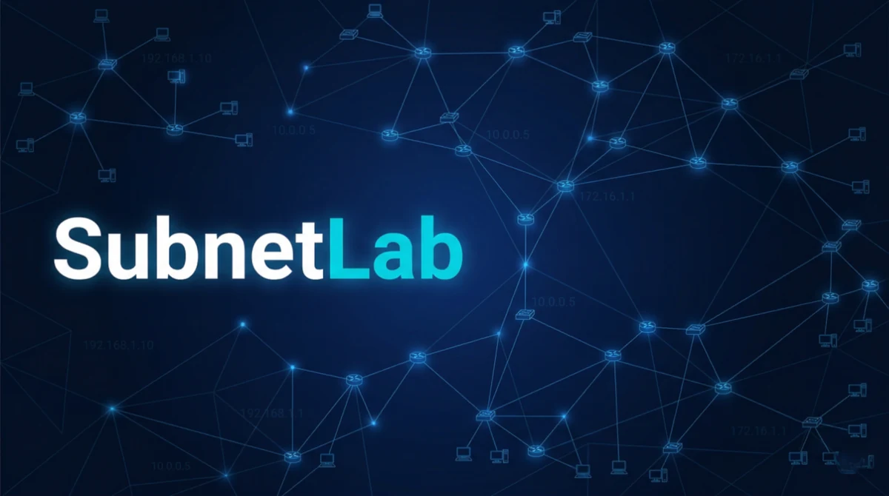

# SubnetLab

<p align="center">
  
</p>


Simulador de estudos para o **CCNA** (Cisco Certified Network Associate).

Projeto pensado e iniciado na turma de CCNA do **professor David de Oliveira**, do
**SENAI Vila Mariana, SP**, como homenagem ao professor e aos alunos de 2026.

Treine para as provas do curso e para a certificação com questões em **português**, explicação da resposta e progresso salvo no seu aparelho.

## Como usar

**Online:** abra **https://qi83.github.io/subnetlab/** no navegador, no PC ou no celular.

**Offline / no celular:** baixe o projeto, abra `index.html` no navegador e use o botão *Instalar* (PWA). Funciona sem internet depois da primeira abertura.

> Dica: no celular, use o menu do navegador → **"Adicionar à tela de início"**. Vira um app.

## O que tem

- **Quiz** com 3 tipos de questão: múltipla escolha, escolha múltipla e associação.
- **Explicação da resposta correta** em toda questão. O objetivo é aprender, não só acertar.
- **Modos**: estudo livre, prova cronometrada (sem feedback até o fim), por tópico, por módulo, revisão de erros e **revisão espaçada de verdade** (algoritmo SM-2).
- **Certificados por módulo**: terminar uma **Prova** com 70% ou mais emite certificado com rank
  (Mestre CCNA, Expert em Redes, CCNA Aprovado, Técnico de Redes). Módulos 1–3 emitem *Conclusão de Curso*;
  a Revisão Completa e a Preparação para Certificação têm os seus. O app guarda **sempre a melhor nota**:
  refazer e tirar menos não apaga o certificado conquistado. Em *Meu perfil* dá para baixar em PNG,
  compartilhar ou imprimir (salvar em PDF pela impressão).
- **Gamificação**: XP, níveis, medalhas, streak e sequência de acertos.
- **Estatísticas** por tópico, por questão e por módulo, com relatório de prontidão.
- **Glossário** de acrônimos (Cisco adora siglas) com tooltip.
- **Código de acesso + sincronização**: o progresso sobe para a nuvem e volta em qualquer aparelho.
  O envio **junta** o que existe em cada aparelho antes de gravar, então nada se perde ao estudar em dois.
- **Ranking da turma** por XP, com selo de offline quando a lista vem do cache.
- **Sino de conquistas**: avisa quando um colega conclui uma prova e ganha certificado.
- **Backup manual** (exportar/importar JSON) dentro do perfil.

### Revisão espaçada (SM-2)

Cada questão guarda `intervalo`, `próxima revisão`, `facilidade` e `repetições`. Acertou, o intervalo
cresce (1 dia → 6 dias → intervalo × facilidade); errou, volta para 1 dia. O card do modo mostra
quantas questões estão vencidas hoje.

## Módulos

| Módulo | Curso | Status |
|---|---|---|
| 1 | ITN (Introduction to Networks) | 🚧 em breve |
| 2 | SRWE (Switching, Routing and Wireless Essentials) | ✅ 60 questões |
| 3 | ENSA (Enterprise Networking, Security, and Automation) | ✅ 55 questões (exame final) |
| 4 | **Preparação para a Certificação** | ✅ **90 questões (Exame 200-301)** |

### Módulo 4: preparação para a certificação

O número do módulo é o **exame de certificação (90 questões)**. As questões de ENSA e SRWE não se
repetem aqui: elas já são os Módulos 3 e 2.

| Seção da tela de módulos | Conteúdo |
|---|---|
| **Módulos do curso** | ITN (em breve), SRWE (60), ENSA (55) |
| **Revisão completa** | as 320 questões de todos os módulos, sem filtro. No modo Prova, são sorteadas **60** questões; no modo Livre, aparecem todas |
| **Certificação** | as 90 questões do exame 200-301 |

O exame de certificação cobre os **três cursos**: SRWE (45 questões), ENSA (29) e ITN (16).

## Estrutura

```
index.html          shell do app
css/styles.css      estilos
js/app.js           lógica
data/modulo2.js     questões do módulo 2 (window.QUESTIONS_M2)
data/modulo2.json   mesma coisa em JSON (para scripts)
data/modulo3.js     questões do módulo 3 (window.QUESTIONS_M3)
data/modulo3.json   mesma coisa em JSON (para scripts)
data/modulo4.js     questões do módulo 4 (window.QUESTIONS_M4)
img/                figuras em WebP, logo, ícones e favicon
manifest.json       PWA
sw.js               service worker (offline)
sql/certificados.sql  tabelas e RPCs de certificados/conquistas (rodar no Supabase)
docs/               especificação da v2.0 e mídia
reference/          simulador original (histórico)
BRIEF.md            especificação técnica do projeto
```

## Nuvem (Supabase)

O app sincroniza por um **código de acesso** (sem senha, sem e-mail): é o identificador do aluno e a credencial.
Não há login. Quem tem o código acessa o progresso, então ele deve ser tratado como segredo.

### Regras de produto

- **Melhor nota não regride**: o certificado só é gravado se a nova nota for maior que a guardada (validado no
  banco, em `cert_put`). Nota menor não sobrescreve, nem local nem na nuvem, e não gera notificação.
- **Conquista só é anunciada quando melhora de fato** na nuvem, o que evita aviso duplicado ao refazer a prova.
- **Sincronização é merge, não substituição**: todo envio (`sbPush`) primeiro puxa o estado da nuvem e junta
  (qStats fica com o registro de mais tentativas, histórico é união sem duplicar, XP é o maior dos dois).
  Sem isso, dois aparelhos se sobrescrevem. Esse bug existiu e foi corrigido.
- **Nunca sincroniza durante o quiz** (evita re-render no meio da questão).

### Tabelas

| Tabela | Colunas | Uso |
|---|---|---|
| `alunos` | `nome, xp, dados, code_hash, criado_em, atualizado_em` | progresso por aluno. Não existe coluna `code`: o código vai em claro só como argumento da RPC, que grava o **SHA-256 em `code_hash`** (sem grant para `anon`) |
| `certificados` | `code, mod, pct, acertos, total, rank, emitido_em, atualizado_em` (PK `code+mod`) | melhor nota por módulo |
| `conquistas` | `id, code, nome, mod, pct, rank, criado_em` | feed global que alimenta o sino |
| `ranking` (view) | `nome, xp, posicao` | classificação da turma (`security_invoker`, sem colunas sensíveis) |

### RPCs (chamadas com a chave pública)

| RPC | Para quê |
|---|---|
| `sync_put(p_code, p_nome, p_xp, p_dados)` | grava o snapshot do progresso |
| `sync_get(p_code)` | lê o snapshot |
| `sync_delete(p_code)` | apaga os dados da nuvem |
| `cert_put(p_code, p_mod, p_pct, p_acertos, p_total, p_rank)` | grava certificado só se melhor; devolve `melhor_pct` e `melhorou` |
| `cert_list(p_code)` | certificados de um aluno (perfil) |
| `conquista_add(...)` / `conquistas_list(p_excluir, p_limite)` | publica e lê o feed do sino (exclui as do próprio aluno) |

### Montar um ambiente novo

1. Crie o projeto no Supabase.
2. Rode `sql/certificados.sql` inteiro no SQL Editor (é idempotente).
3. Garanta o RLS da tabela `alunos` com **privilégio por coluna**: `grant select (nome, xp) to anon`,
   sem isso a view `ranking` (com `security_invoker = true`) fica vazia, e com grant amplo a chave pública
   leria `dados` (onde está o código de acesso).
4. Ajuste `SB_URL` e `SB_KEY` no topo do `js/app.js`.

> Armadilha conhecida: sem `security_invoker = true` a view ignora RLS e o Advisor do Supabase marca
> *Security Definer View* como Critical.

## Adicionar questões

Crie `data/moduloN.js`:

```js
window.QUESTIONS_M3 = [
  {
    id: 1, mod: 3,
    fonte: "curso",                   // M2/M3: "curso" | M4: "ensa" | "srwe" | "cert"
    tp: "OSPF",                       // tópico
    ty: "single",                     // single | multi | match
    text: "Enunciado em português.",
    opts: ["Alternativa A", "Alternativa B", "Alternativa C"],
    cor: 1,                           // single: índice | multi: array de índices
    sub: "Resumo curto da resposta",
    why: "Explicação didática do porquê.",
    fig: "img/m3-q01.webp",           // opcional: figura original da fonte
    figAlt: "Descrição da figura",    // opcional
    code: "R1# show ip ospf\n...",    // opcional: tela CLI (só quando a figura é só comandos)
    pairs: [{ l: "lado A", r: "lado B" }]  // só para ty: "match"
  }
];
```

Depois inclua o `<script defer src="data/moduloN.js">` no `index.html`. O app detecta automaticamente qualquer `window.QUESTIONS_M*`.

### 📌 Regra obrigatória: figuras originais

**Toda figura de questão deve ser a imagem original da fonte oficial, nunca uma recriação ou desenho "representativo".**

Figuras redesenhadas mudam detalhes (nomes de interface, IPs, rótulos, topologia) e o aluno acaba treinando num cenário diferente do da prova.

Passo a passo:
1. Localize a imagem original na fonte da questão.
2. Baixe o arquivo original (não redesenhe).
3. Converta para WebP, largura máx. 900px, qualidade ~82-84.
4. Salve em `img/m<modulo>-q<id>.webp`.
5. Referencie: `fig: "img/m3-q021.webp"` + `figAlt` com descrição curta e fiel.
6. Sem figura na fonte? Deixe `fig` vazio, **não invente**.

## Acessibilidade

Auditado com **axe-core 4.10** (WCAG 2.1 A + AA) nas telas de login, trilha, escolha de modo, quiz, resultado,
gabarito, ranking, perfil, guia e nos modais, nos **dois temas**. Estado atual: zero violações.

O que foi corrigido (e por quê, para não voltar):

- **Cards da trilha eram `div role="button"` com um botão dentro**: controle aninhado, proibido. Agora: card
  não selecionado é um `<button>` de verdade ("Selecionar módulo X"); o selecionado é um `div` com o CTA.
  Seleção por teclado funciona com Enter/Espaço e o foco tem contorno visível.
- **Modais sem papel**: todos passam por `mountModal()` com `role="dialog"`, `aria-modal="true"`, nome vindo do
  título, foco preso dentro da caixa, `Esc` fecha e o foco volta para quem abriu.
- **Barras de progresso sem nome**: `aria-label` em "Progresso para o próximo nível" e "Progresso da sessão".
- **Contraste**: `--text3` do tema claro (#6B7280 → #4B5563), texto do percentual por desempenho com variante
  por tema (`pctText`), iniciais do avatar com cor calculada pela luminância do fundo (`corTextoAvatar`), cores
  de `corDoNome` escurecidas (48% → 28% de luminosidade), tag de tópico com texto neutro e faixa colorida, e
  alternativa apagada (`.opt.dim`) sem `opacity`: o texto estava em ~1,9:1.

Regra: **cor usada em barra não serve como cor de texto** no tamanho em que o app usa (11–13px). Precisa de
variante mais clara (tema escuro) ou mais escura (tema claro), e a checagem é sempre medida, não estimada.

## Smoke test de UI

```bash
node tools/smoke-ui.js          # headless, ~25 s
node tools/smoke-ui.js --headed # com janela, para acompanhar
```

Zero dependências: usa o `WebSocket` nativo do Node 21+ para falar CDP com o Chromium, e sobe o
servidor estático sozinho (não precisa de `python -m http.server`). O binário do navegador é procurado
em `CHROME_PATH`, no Chromium do Hermes e nos caminhos padrão.

Percorre o caminho que mais quebrou: carrega o app → login → **selecionar módulo sem entrar** → entra pelo
CTA → responde 3 questões (tratando múltipla escolha e associação) → encerra a sessão → abre o **Gabarito**
→ busca, confere o destaque da resposta, a explicação e o aviso de consulta → navega entre 3 questões →
volta para a lista. Sai com código 1 se qualquer passo falhar, e falha também em qualquer erro de JS.

A verificação mais importante é a do Gabarito: compara `sl_qstats`, `sl_xp_total`, `sl_history` e
`sl_spaced` **antes e depois** de consultar, byte a byte. Validei com teste negativo: injetei uma
escrita no gabarito, o smoke falha apontando a diferença exata.

## Validar o conteúdo

```bash
node tools/validar-conteudo.js
```

Verifica o banco de questões dos módulos 2, 3 e 4. Falha com exit 1 se encontrar **erros** (exit 0 se só avisos).

O que é checado como ERROR:
- `id` duplicado no mesmo módulo ou não-inteiro-positivo
- campos obrigatórios ausentes (`tp`, `ty`, `text`, `why`)
- `ty` desconhecido (esperado `single | multi | match`)
- `single`: `opts` com menos de 2 itens ou `cor` fora do intervalo
- `multi`: `cor` não-array, índice fora do intervalo ou duplicado
- `match`: `pairs` com menos de 2 pares ou par com `l`/`r` vazio
- `fig` referenciando arquivo que não existe em `img/`

Avisos (WARN, não falha): texto duplicado, `tp` com espaços, `opts` duplicados, imagens órfãs em `img/`.

```
node tools/validar-conteudo.js --quiet   # só erros
node tools/validar-conteudo.js --help
```

## Rodar localmente

Nenhum build, nenhuma dependência. Duplo clique em `index.html`.

Se quiser servir por HTTP (recomendado para testar o PWA):

```bash
python -m http.server 8000
# abra http://localhost:8000
```

## Contribuir

Sugestões e correções de questões são bem-vindas: abra uma *issue* ou mande no grupo da turma.

## Aviso

Projeto de estudo, sem fins comerciais. As questões derivam do material público do curso CCNA da Cisco Networking Academy. Cisco, CCNA e NetAcad são marcas da Cisco Systems, Inc.
